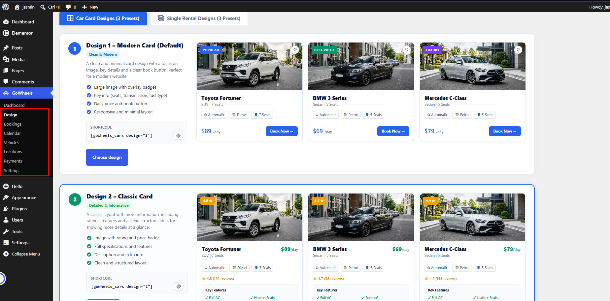
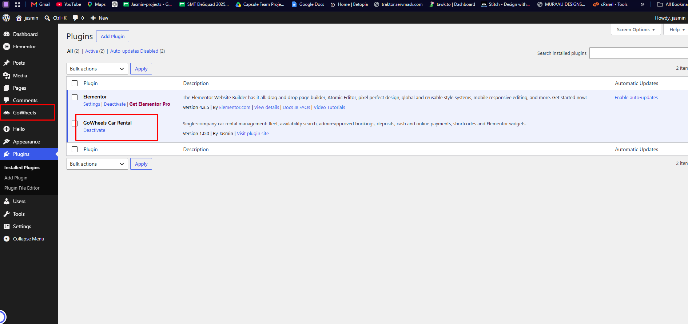

# GoWheels - Modern Car Rental WordPress Plugin

[](https://wordpress.org)
[](https://www.php.net)
[](https://elementor.com)
[](https://www.gnu.org/licenses/gpl-2.0.html)

**GoWheels Car Rental** is a complete, enterprise-grade car rental and fleet management plugin for WordPress. Designed for single-company rental operators, luxury fleets, chauffeur services, and boutique car rental businesses, GoWheels delivers real-time availability searches, intuitive booking workflows, customizable pricing rules, and a visual **Design Studio** with 1-click preset switching.

---

## 📸 Screenshots & Showcase

### 🎨 Design Studio (1-Click Presets & Shortcode Generator)
Choose between multiple curated card layouts and single rental detail pages with live visual previews and instant shortcodes.



### 🔌 Seamless WordPress Integration
Lightweight, modular architecture that installs in seconds and integrates smoothly with Elementor and modern block themes.



---

## ✨ Key Highlights

- **Visual Design Studio**: Switch between 3 frontend Car Card presets and 3 Single Rental page designs with zero coding required.
- **Interactive Fleet Showcase**: Display vehicles in responsive modern grids, compact lists, or category tabs with instant availability filtering.
- **Smart Booking Engine**: Live date/time pickers with real-time overlap prevention, minimum rental duration enforcement, and instant price quotes.
- **Flexible Pricing Rules**: Support for daily and hourly rental rates, customizable deposit percentages, taxes, and currency options.
- **Admin Approval Workflow**: Review bookings before accepting payments with statuses (`Pending`, `Approved`, `Active`, `Completed`, `Cancelled`).
- **Interactive Booking Calendar**: Visual timeline of all reservations and fleet schedule in the WordPress dashboard.
- **Payment Flexibility**: Built-in support for Cash on Arrival, Direct Bank Transfer, and online payment gateways.
- **Elementor & Shortcode Ready**: Use dedicated shortcodes or native widgets across any WordPress page builder.
- **High Performance & Safe**: Built with strict recursion guards, zero-bloat CSS isolation (`.gw-*`), and full compatibility with PHP 8.2+.

---

## 🎨 Design Studio Presets

GoWheels comes out of the box with 3 curated Car Card styles and 3 Single Vehicle Rental page layouts:

### 1. Car Card Presets (Fleet Listing)
| Preset | Style Name | Shortcode | Key Features |
|---|---|---|---|
| **Design 1** | **Modern Card** *(Default)* | `[gowheels_cars design="1"]` | Clean & minimal, high-contrast overlay badges, wishlist icon, vibrant blue CTA. |
| **Design 2** | **Classic Card** | `[gowheels_cars design="2"]` | Detailed layout, customer rating badge (`★ 4.8`), key features checklist, energetic green CTA. |
| **Design 3** | **Compact Card** | `[gowheels_cars design="3"]` | Horizontal space-saving row, pill badges, prominent daily price, sleek outline CTA. |

### 2. Single Rental Detail Presets
| Preset | Style Name | Shortcode | Key Features |
|---|---|---|---|
| **Design 1** | **Classic Detail** *(Default)* | `[gowheels_single design="1"]` | Side-by-side showcase with gallery thumbnail strip, trust badges, specs grid, and sticky booking card. |
| **Design 2** | **Luxury Detail** | `[gowheels_single design="2"]` | Full-width hero image with premium dark accents, luxury badge, and streamlined pricing banner. |
| **Design 3** | **Split Layout** | `[gowheels_single design="3"]` | Modern 50/50 split layout optimized for high conversion and mobile browsing. |

> **Pro Tip**: In your admin dashboard under **GoWheels → Design**, selecting a design preset sets the default across your entire site automatically!

---

## 📋 Shortcode Reference

You can drop these shortcodes into any page, post, or widget area:

| Shortcode | Description | Available Attributes |
|---|---|---|
| `[gowheels_cars]` | Displays your vehicle fleet with filter & sorting. | `design="1\|2\|3"`, `columns="1-4"`, `limit="12"`, `layout="grid\|tabs"` |
| `[gowheels_cars_tabs]` | Displays vehicles grouped by type/category in tabs. | `design="1\|2\|3"`, `limit="12"` |
| `[gowheels_single]` | Renders a detailed vehicle presentation. | `id="123"`, `design="1\|2\|3"` |
| `[gowheels_search]` | Embeds the pickup & return availability search bar. | `layout="horizontal\|vertical"` |
| `[gowheels_booking]` | Displays the interactive booking form and date picker. | `vehicle_id="123"` |
| `[gowheels_confirmation]` | Customer booking receipt and status confirmation page. | — |

---

## 🚀 Installation & Quick Start

1. **Download**: Download `gowheels-car-rental.zip` or clone this repository:
   ```bash
   git clone https://github.com/jasminaramim/GoWheels-Car-Rental-plugin.git wp-content/plugins/gowheels-car-rental
   ```
2. **Install**:
   - Go to your WordPress Admin → **Plugins → Add New → Upload Plugin**.
   - Select the zip archive and click **Install Now**, then click **Activate**.
3. **Configure**:
   - Navigate to **GoWheels → Settings** to set your currency, booking rules, and notification emails.
   - Go to **GoWheels → Design** to choose your favorite card preset and single car rental template.
4. **Add Vehicles**:
   - Go to **GoWheels → Vehicles → Add New Vehicle** to add your fleet with photos, prices, seats, and features.
5. **Publish Pages**:
   - Add `[gowheels_cars]` on your fleet page or use Elementor to design custom pages.

---

## 🛠️ System Requirements

- **WordPress**: 6.0 or higher
- **PHP**: 7.4, 8.0, 8.1, or 8.2+
- **MySQL / MariaDB**: 5.7+ / 10.3+
- **Page Builders**: Compatible with Elementor, Gutenberg (Block Editor), and classic themes.

---

## 🔒 Security & Performance

- **Non-blocking Architecture**: Database schema uses indexed lookup keys for fast availability queries.
- **Anti-recursion Protections**: Safe excerpt processing prevents infinite loops during block rendering.
- **Capability Scoped**: Granular permissions ensure sensitive booking data is restricted to authorized rental managers.
- **Sanitized & Escaped**: Follows standard WordPress Security & Coding Standards (WPCS).

---

## 👤 Author

Developed by **[Jasmin](https://github.com/jasminaramim)**.

## 📄 License

This project is open-source software licensed under the [GNU General Public License v2.0 or later](https://www.gnu.org/licenses/gpl-2.0.html).
